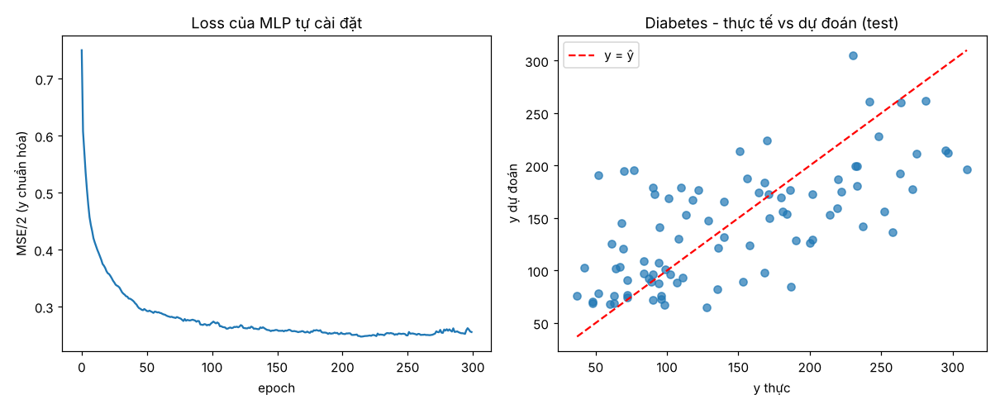
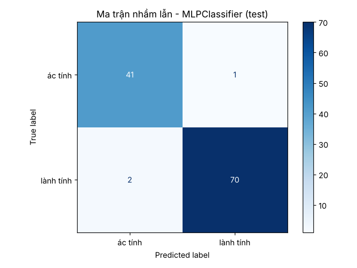
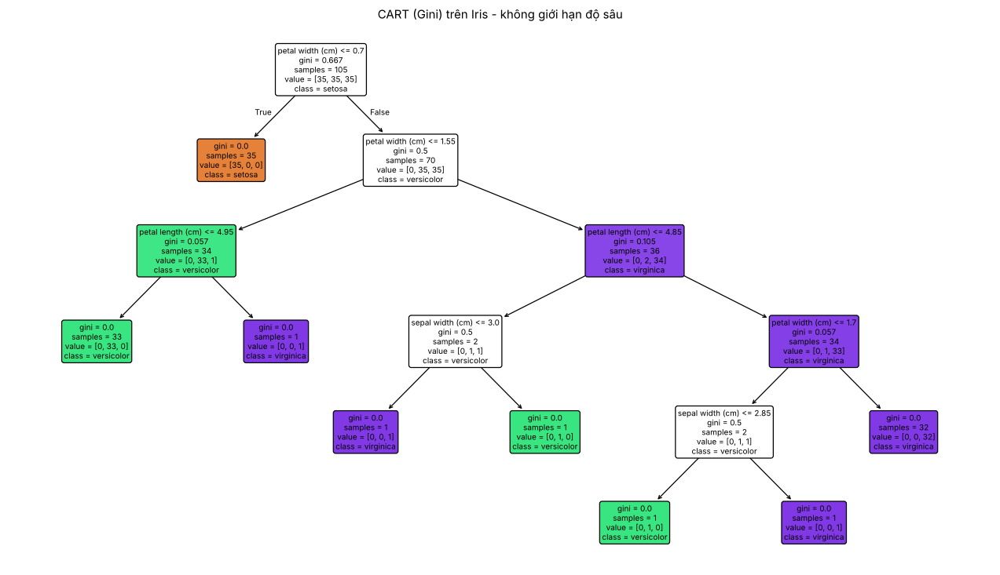
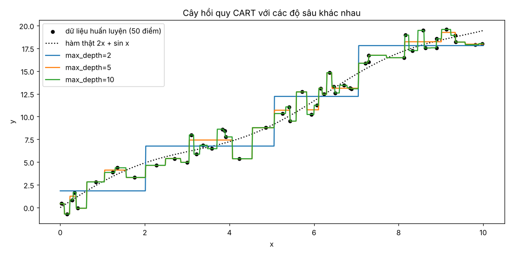
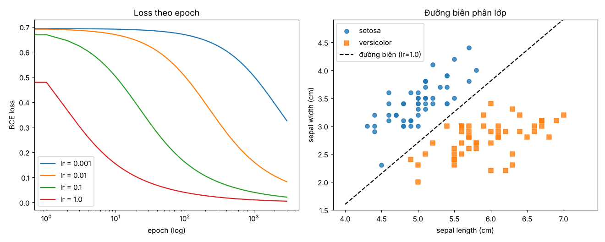
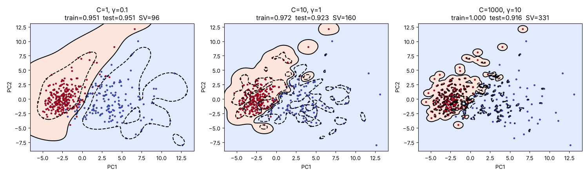

# Bài tập Học máy — Chương 4, 5, 6

> Giáo trình: *Bài tập Học máy* — Trường ĐH Thủy Lợi (TS. Tạ Quang Chiểu, TS. Nguyễn Thị Kim Ngân).
>
> - **Chương 4** – Mạng nơ-ron nhân tạo
> - **Chương 5** – Phương pháp học theo mô hình cây
> - **Chương 6** – Hồi quy logistic, Máy vector hỗ trợ (SVM)
>
> Trong phần trắc nghiệm, đáp án đúng được **in đậm** và đánh dấu ✅, lời giải thích nằm ngay bên dưới.
> Các bài code nằm trong `chuong4/`, `chuong5/`, `chuong6/`; test nằm trong `tests/` (chạy `pytest`).
> Mọi con số trong file này đều lấy từ việc chạy chính code trong repo (seed cố định nên chạy lại sẽ ra đúng như vậy).

## Mục lục

- [Chương 4 – Mạng nơ-ron nhân tạo](#chương-4--mạng-nơ-ron-nhân-tạo)
  - [A. Trắc nghiệm](#4a-trắc-nghiệm) · [B. Tự luận & bài tập](#4b-tự-luận-và-bài-tập)
- [Chương 5 – Phương pháp học theo mô hình cây](#chương-5--phương-pháp-học-theo-mô-hình-cây)
  - [A. Trắc nghiệm](#5a-trắc-nghiệm) · [B. Tự luận & bài tập](#5b-tự-luận-và-bài-tập)
- [Chương 6 – Hồi quy logistic, SVM](#chương-6--hồi-quy-logistic-máy-vector-hỗ-trợ)
  - [A. Trắc nghiệm](#6a-trắc-nghiệm) · [B. Tự luận & bài tập](#6b-tự-luận-và-bài-tập)
- [Hướng dẫn chạy code](#hướng-dẫn-chạy-code-và-test)

---

# Chương 4 – Mạng nơ-ron nhân tạo

## 4.A Trắc nghiệm

**Bảng đáp án nhanh**

| Câu | 4.1 | 4.2 | 4.3 | 4.4 | 4.5 | 4.6 | 4.7 | 4.8 | 4.9 | 4.10 |
|---|---|---|---|---|---|---|---|---|---|---|
| Đáp án | B | C | B | C | C | A | B | B | D | A |
| **Câu** | **4.11** | **4.12** | **4.13** | **4.14** | **4.15** | **4.16** | **4.17** | **4.18** | **4.19** | **4.20** |
| Đáp án | D | C | B | A | B | C | A | C | C | D |

---

**4.1** Trong nơ-ron nhân tạo, các giá trị $x_1, x_2, \dots, x_m$ được gọi là:
A. Trọng số  
**B. Đầu vào ✅**  
C. Bias  
D. Đầu ra

> **Giải thích:** Nơ-ron tính $z=\sum_i w_i x_i + b$. Các $x_i$ là tín hiệu/đặc trưng đi vào nơ-ron (đầu vào); $w_i$ mới là trọng số, $b$ là bias, còn $f(z)$ là đầu ra.

**4.2** Trong nơ-ron nhân tạo, $w_i$ biểu diễn:
A. Đầu vào  
B. Sai số  
**C. Trọng số kết nối ✅**  
D. Đầu ra

> **Giải thích:** $w_i$ là hệ số nhân với đầu vào $x_i$, thể hiện "độ mạnh" của liên kết giữa đầu vào $i$ và nơ-ron. Đây chính là tham số mạng học được trong quá trình huấn luyện.

**4.3** Bias trong mạng nơ-ron thường được sử dụng để:
A. Tăng số lượng dữ liệu  
**B. Dịch chuyển hàm kích hoạt ✅**  
C. Giảm số nơ-ron  
D. Chuẩn hóa dữ liệu

> **Giải thích:** Với $f(w^\top x + b)$, thay đổi $b$ làm đồ thị hàm kích hoạt tịnh tiến sang trái/phải (ngưỡng kích hoạt thay đổi). Không có bias, siêu phẳng quyết định luôn bị buộc đi qua gốc tọa độ, làm giảm khả năng biểu diễn.

**4.4** Tầng nào của mạng nơ-ron nhận dữ liệu trực tiếp từ bên ngoài?
A. Hidden Layer  
B. Output Layer  
**C. Input Layer ✅**  
D. Activation Layer

> **Giải thích:** Tầng đầu vào nhận trực tiếp vector đặc trưng $x$ từ dữ liệu; mỗi nơ-ron vào tương ứng một đặc trưng. "Activation Layer" không phải một tầng chuẩn trong cấu trúc mạng.

**4.5** Tầng nào của mạng nơ-ron tạo ra kết quả dự đoán cuối cùng?
A. Input Layer  
B. Hidden Layer  
**C. Output Layer ✅**  
D. Bias Layer

> **Giải thích:** Tầng đầu ra sinh $\hat y$: một số thực (hồi quy), một xác suất (sigmoid, phân lớp nhị phân) hoặc vector xác suất (softmax, đa lớp).

**4.6** Trong mạng nơ-ron nhân tạo, tầng ẩn là tầng:
**A. Nằm giữa tầng đầu vào và tầng đầu ra ✅**  
B. Tạo ra kết quả dự đoán cuối cùng  
C. Nhận dữ liệu trực tiếp từ tập dữ liệu  
D. Chỉ chứa các bias

> **Giải thích:** Theo định nghĩa, mọi tầng không phải input và output là tầng ẩn, chúng nằm giữa hai tầng này. B là tầng ra, C là tầng vào.

**4.7** Tại sao gọi là "tầng ẩn"?
A. Vì không có nơ-ron nào trong tầng  
**B. Vì người dùng không quan sát trực tiếp các giá trị của tầng này từ dữ liệu đầu vào hoặc đầu ra ✅**  
C. Vì tầng này luôn có giá trị bằng 0  
D. Vì tầng này không tham gia tính toán

> **Giải thích:** Dữ liệu huấn luyện chỉ cho biết $x$ (đầu vào) và $y$ (đầu ra mong muốn); không có "nhãn" nào cho giá trị tại các nơ-ron ở giữa. Mạng tự học các biểu diễn trung gian này nên chúng "ẩn" với người quan sát.

**4.8** Vai trò chính của tầng ẩn là:
A. Lưu trữ dữ liệu huấn luyện  
**B. Trích xuất và học các đặc trưng từ dữ liệu ✅**  
C. Chuẩn hóa dữ liệu  
D. Chia dữ liệu thành các nhóm

> **Giải thích:** Mỗi tầng ẩn biến đổi phi tuyến biểu diễn của tầng trước thành biểu diễn mới, trừu tượng hơn (ví dụ ảnh: cạnh → hình dạng → đối tượng). Đây là cơ chế "học đặc trưng" tự động.

**4.9** Trong sklearn, `hidden_layer_sizes=(3,2)` nghĩa là:
A. Một tầng ẩn gồm 5 nơ-ron  
B. Hai tầng đầu ra  
C. Ba tầng ẩn  
**D. Hai tầng ẩn, lần lượt có 3 và 2 nơ-ron ✅**

> **Giải thích:** Tuple có độ dài = số tầng ẩn; phần tử thứ $i$ = số nơ-ron của tầng ẩn thứ $i$. Tầng vào/ra do sklearn tự xác định từ dữ liệu.

**4.10** Mục đích của việc sử dụng nhiều tầng ẩn là:
**A. Học được các mối quan hệ phi tuyến phức tạp hơn ✅**  
B. Giảm số lượng trọng số  
C. Loại bỏ dữ liệu nhiễu  
D. Giảm kích thước dữ liệu

> **Giải thích:** Mỗi tầng là một phép biến đổi phi tuyến; xếp chồng nhiều tầng tạo ra hàm hợp phức tạp, biểu diễn được quan hệ phi tuyến phức tạp với số nơ-ron ít hơn so với mạng nông. Thêm tầng thì số trọng số **tăng** chứ không giảm (B sai).

**4.11** Nếu tất cả nơ-ron ở tầng ẩn dùng hàm tuyến tính $f(x)=x$ thì thêm nhiều tầng ẩn sẽ:
A. Luôn làm tăng độ chính xác  
B. Giảm số trọng số  
C. Loại bỏ overfitting  
**D. Không làm tăng khả năng biểu diễn phi tuyến của mạng ✅**

> **Giải thích:** $W^{(3)}\big(W^{(2)}(W^{(1)}x)\big) = (W^{(3)}W^{(2)}W^{(1)})x = W'x$. Hợp của các ánh xạ tuyến tính vẫn là một ánh xạ tuyến tính, nên mạng nhiều tầng tuyến tính tương đương mạng một tầng. Vì vậy hàm kích hoạt phi tuyến là bắt buộc.

**4.12** Một tầng ẩn 5 nơ-ron nhận tín hiệu từ 3 đầu vào. Không tính bias, số trọng số cần học là:
A. 8  
B. 10  
**C. 15 ✅**  
D. 20

> **Giải thích:** Kết nối đầy đủ (fully connected): mỗi nơ-ron trong 5 nơ-ron nối với cả 3 đầu vào → $3 \times 5 = 15$ trọng số (ma trận $W$ kích thước $5\times 3$). Có test kiểm chứng trong `tests/test_chuong4.py::test_cau_4_12_so_trong_so`.

**4.13** Lan truyền xuôi (Forward Propagation) là quá trình:
A. Tính gradient  
**B. Tính đầu ra của mạng từ dữ liệu đầu vào ✅**  
C. Cập nhật trọng số  
D. Chuẩn hóa dữ liệu

> **Giải thích:** Tín hiệu đi một chiều từ input → hidden → output, mỗi tầng tính $z=Wa+b$, $a=f(z)$ để ra $\hat y$. Tính gradient (A) là việc của backpropagation, cập nhật trọng số (C) là việc của gradient descent.

**4.14** Hàm mất mát (Loss Function) được sử dụng để:
**A. Đo mức độ sai khác giữa giá trị dự đoán và giá trị thực ✅**  
B. Tăng số lượng nơ-ron  
C. Giảm kích thước dữ liệu  
D. Tạo dữ liệu mới

> **Giải thích:** Ví dụ MSE $\frac{1}{2}(y-\hat y)^2$ hay cross-entropy. Loss là "thước đo lỗi" mà quá trình huấn luyện cần cực tiểu hóa.

**4.15** Backpropagation được sử dụng để:
A. Tính đầu ra của mạng  
**B. Tính gradient của hàm mất mát ✅**  
C. Chuẩn hóa dữ liệu  
D. Tăng số tầng ẩn

> **Giải thích:** Backpropagation áp dụng quy tắc dây chuyền (chain rule) để tính hiệu quả $\partial J/\partial W^{(l)}$ cho mọi tầng. Bản thân nó chỉ tính gradient; việc cập nhật trọng số do gradient descent đảm nhận.

**4.16** Trong quá trình lan truyền ngược, sai số được truyền theo hướng:
A. Input → Output  
B. Input → Hidden  
**C. Output → Input ✅**  
D. Ngẫu nhiên

> **Giải thích:** Sai số được tính ở tầng ra trước ($\delta^{(L)}$), rồi lan dần về các tầng trước: $\delta^{(l)} = (W^{(l+1)})^\top \delta^{(l+1)} \odot f'(z^{(l)})$, đúng chiều ngược với lan truyền xuôi.

**4.17** Gradient Descent được sử dụng để:
**A. Cập nhật trọng số nhằm giảm hàm mất mát ✅**  
B. Tăng số lượng dữ liệu  
C. Chia dữ liệu thành các cụm  
D. Chuẩn hóa dữ liệu

> **Giải thích:** Quy tắc cập nhật $W \leftarrow W - \eta \,\partial J/\partial W$: đi ngược hướng gradient (hướng loss giảm nhanh nhất).

**4.18** Mục tiêu cuối cùng của quá trình huấn luyện mạng nơ-ron là:
A. Tăng số lượng tầng  
B. Tăng số lượng trọng số  
**C. Giảm giá trị của hàm mất mát ✅**  
D. Tăng số lượng mẫu dữ liệu

> **Giải thích:** Huấn luyện chính là bài toán tối ưu: tìm bộ tham số $W, b$ làm cực tiểu $J$ (và qua đó dự đoán tốt trên dữ liệu mới). Các phương án còn lại là quyết định thiết kế hoặc thu thập dữ liệu, không phải mục tiêu tối ưu.

**4.19** Mạng 2–2–1, ReLU, không bias, $x=[1,2]^\top$, $W^{(1)}=I$, $W^{(2)}=[1\ 1]$. Giá trị đầu ra là:
A. 1  
B. 2  
**C. 3 ✅**  
D. 4

> **Giải thích:** $z^{(1)} = W^{(1)}x = [1,2]^\top$, $a^{(1)}=\mathrm{ReLU}(z^{(1)})=[1,2]^\top$; $z^{(2)}=W^{(2)}a^{(1)}=1+2=3$, $\hat y=\mathrm{ReLU}(3)=3$. (Xem chi tiết ở bài 4.24.)

**4.20** Cùng mạng trên, $y=5$, $J=\frac12(y-\hat y)^2$. Tính $\partial J/\partial W^{(2)}$:
A. [2, 4]  
B. [1, 2]  
C. [-1, -2]  
**D. [-2, -4] ✅**

> **Giải thích:** $\partial J/\partial \hat y = -(y-\hat y) = -(5-3) = -2$; $\mathrm{ReLU}'(z^{(2)}=3)=1$ nên $\delta^{(2)}=-2$. $\partial J/\partial W^{(2)} = \delta^{(2)}\,(a^{(1)})^\top = -2\cdot[1,2]=[-2,-4]$. Dấu âm nghĩa là cần **tăng** $W^{(2)}$ để $\hat y$ tiến lên 5.

## 4.B Tự luận và bài tập

### 4.21 Cấu trúc mạng nơ-ron nhiều lớp (MLP)

**Cấu trúc.** Một MLP gồm các tầng nơ-ron xếp nối tiếp, kết nối đầy đủ (mỗi nơ-ron tầng $l$ nối với mọi nơ-ron tầng $l-1$):

```
  Input layer        Hidden layer 1        Hidden layer 2        Output layer
   x1 ──┐            ┌─ h1(1) ─┐           ┌─ h1(2) ─┐
   x2 ──┼──W(1),b(1)─┼─ h2(1) ─┼─W(2),b(2)─┼─ h2(2) ─┼──W(3),b(3)──  ŷ
   ...  │            │   ...   │           │   ...   │
   xm ──┘            └─ hk(1) ─┘           └─ hp(2) ─┘
```

Mỗi nơ-ron $j$ ở tầng $l$ tính: $z^{(l)}_j = \sum_i W^{(l)}_{ji} a^{(l-1)}_i + b^{(l)}_j$, rồi $a^{(l)}_j = f(z^{(l)}_j)$, với $f$ là hàm kích hoạt (ReLU, sigmoid, tanh...).

**Vai trò từng tầng**

| Tầng | Vai trò |
|---|---|
| **Input Layer** | Nhận trực tiếp vector đặc trưng $x \in \mathbb{R}^m$ (số nơ-ron = số đặc trưng). Không có trọng số, không tính toán; chỉ chuyển dữ liệu (thường đã chuẩn hóa) vào mạng. |
| **Hidden Layer** | Thực hiện các phép biến đổi phi tuyến liên tiếp, tự động **học đặc trưng**: tầng đầu học các đặc trưng đơn giản, các tầng sau tổ hợp chúng thành đặc trưng trừu tượng hơn. Số tầng và số nơ-ron quyết định "dung lượng" (capacity) của mô hình. |
| **Output Layer** | Tạo dự đoán cuối cùng. Số nơ-ron và hàm kích hoạt phụ thuộc bài toán: hồi quy → 1 nơ-ron tuyến tính (MSE); phân lớp nhị phân → 1 nơ-ron sigmoid (binary cross-entropy); phân lớp $K$ lớp → $K$ nơ-ron softmax (cross-entropy). |

**Tại sao mạng nhiều tầng học được quan hệ phi tuyến phức tạp?**

1. **Hàm kích hoạt phi tuyến:** nếu không có nó, mọi tầng gộp lại chỉ là một ma trận tuyến tính (xem câu 4.11). Nhờ $f$ phi tuyến, mỗi tầng "bẻ cong" không gian dữ liệu.
2. **Hàm hợp:** mạng $L$ tầng biểu diễn $\hat y = f_L(\dots f_2(f_1(x)))$. Hợp của nhiều hàm phi tuyến đơn giản tạo ra hàm rất phức tạp; ví dụ với ReLU, số vùng tuyến tính từng khúc tăng theo cấp số nhân khi số tầng tăng, nhưng chỉ tăng đa thức khi số nơ-ron trong một tầng tăng.
3. **Định lý xấp xỉ vạn năng:** MLP chỉ với 1 tầng ẩn đủ rộng và hàm kích hoạt phi tuyến đã xấp xỉ được mọi hàm liên tục trên miền compact với độ chính xác tùy ý. Mạng sâu đạt điều đó với ít tham số hơn.
4. **Học biểu diễn phân cấp:** các tầng sau làm việc trên các đặc trưng mà tầng trước đã học, nên dữ liệu không tách được tuyến tính trong không gian gốc (ví dụ XOR) trở nên tách được ở không gian ẩn. Code `chuong4/mlp_numpy.py` có demo XOR: mạng 1 tầng ẩn 8 nơ-ron học đúng 4/4 mẫu.

### 4.22 Quá trình lan truyền xuôi (Forward Propagation)

Lan truyền xuôi là việc tính đầu ra $\hat y$ từ đầu vào $x$ qua từng tầng theo thứ tự input → output.

**Thuật toán** (mạng $L$ tầng, $a^{(0)} = x$):

```
for l = 1 .. L:
    z(l) = W(l) · a(l-1) + b(l)        # tổ hợp tuyến tính
    a(l) = f(l)( z(l) )                # hàm kích hoạt
ŷ = a(L)
J = Loss(y, ŷ)
```

- $W^{(l)}$ có kích thước $(n_l \times n_{l-1})$, $b^{(l)}$ kích thước $(n_l)$.
- Với một mini-batch $X$ ($N$ mẫu theo hàng), viết dạng ma trận: $Z^{(l)} = A^{(l-1)}W^{(l)\top} + b^{(l)}$ để tính song song.
- Hàm $f^{(L)}$ ở tầng ra chọn theo bài toán (tuyến tính / sigmoid / softmax).
- **Cần lưu lại** mọi $z^{(l)}, a^{(l)}$ vì lan truyền ngược dùng lại chúng (bộ nhớ "cache").

**Ví dụ số:** xem bài 4.24 bên dưới. Trong code, hàm `MLP._forward` (`chuong4/mlp_numpy.py`) cài đặt đúng các bước này và trả về danh sách `Zs`, `As`.

### 4.23 Nguyên lý thuật toán lan truyền ngược (Backpropagation)

**Ý tưởng:** loss $J$ là hàm hợp của mọi trọng số. Backprop dùng **quy tắc dây chuyền** để tính $\partial J/\partial W^{(l)}$ cho mọi tầng chỉ với *một* lượt đi ngược, tái sử dụng kết quả của tầng sau cho tầng trước. Chi phí vì vậy chỉ cỡ một lượt forward, thay vì phải tính đạo hàm riêng lẻ cho từng trọng số.

**Các bước** (định nghĩa sai số tầng $l$: $\delta^{(l)} = \partial J/\partial z^{(l)}$):

1. **Forward:** tính và lưu $z^{(l)}, a^{(l)}$ cho mọi tầng, tính $J$.
2. **Sai số tầng ra:** $\delta^{(L)} = \dfrac{\partial J}{\partial a^{(L)}} \odot f'^{(L)}(z^{(L)})$.
   (Với cặp MSE + tuyến tính, BCE + sigmoid, CE + softmax, biểu thức rút gọn thành $\delta^{(L)} = \hat y - y$.)
3. **Lan truyền ngược** cho $l = L-1, \dots, 1$: $\delta^{(l)} = \big(W^{(l+1)}\big)^\top \delta^{(l+1)} \odot f'(z^{(l)})$.
4. **Gradient tham số:** $\dfrac{\partial J}{\partial W^{(l)}} = \delta^{(l)} \big(a^{(l-1)}\big)^\top$, $\dfrac{\partial J}{\partial b^{(l)}} = \delta^{(l)}$.
5. **Cập nhật** (gradient descent): $W^{(l)} \leftarrow W^{(l)} - \eta\, \partial J/\partial W^{(l)}$.

**Các khái niệm**

| Khái niệm | Ý nghĩa | Vai trò trong huấn luyện |
|---|---|---|
| **Gradient** $\nabla_W J$ | Vector các đạo hàm riêng của $J$ theo từng tham số; chỉ hướng làm $J$ **tăng** nhanh nhất, độ lớn cho biết độ dốc. | Cho biết mỗi trọng số cần điều chỉnh theo chiều nào và mạnh tới đâu để giảm lỗi. Backprop là cách tính gradient hiệu quả. |
| **Gradient Descent** | Thuật toán tối ưu lặp: $\theta \leftarrow \theta - \eta \nabla_\theta J$, tức đi ngược hướng gradient. Các biến thể: batch GD (toàn bộ dữ liệu), SGD (1 mẫu), mini-batch GD (một nhóm mẫu), cùng các cải tiến Momentum và Adam. | Là "động cơ" cập nhật trọng số qua nhiều epoch để loss giảm dần tới cực tiểu (thường là cực tiểu địa phương vì loss của mạng nơ-ron không lồi). |
| **Learning rate** $\eta$ | Độ dài bước nhảy mỗi lần cập nhật. | $\eta$ quá nhỏ: hội tụ rất chậm. $\eta$ quá lớn: loss dao động hoặc phân kỳ. $\eta$ phù hợp: hội tụ nhanh và ổn định. Thường chọn qua thực nghiệm, kết hợp lịch giảm dần (learning-rate decay) hoặc thuật toán thích nghi như Adam. Xem minh họa ở Chương 6, Bài 2. |

**Kiểm chứng:** `tests/test_chuong4.py::test_backprop_khop_gradient_so` so sánh gradient do backprop tính với gradient số (sai phân trung tâm $\frac{J(w+\epsilon)-J(w-\epsilon)}{2\epsilon}$) cho cả hồi quy, phân lớp nhị phân và đa lớp. Hai cách cho kết quả khớp nhau, chứng tỏ backprop được cài đúng.

### 4.24 Tính lan truyền xuôi bằng tay

Cho $x=\begin{bmatrix}1\\2\end{bmatrix}$, $W^{(1)}=\begin{bmatrix}1&0\\0&1\end{bmatrix}$, $W^{(2)}=\begin{bmatrix}1&1\end{bmatrix}$, ReLU, không bias.

*(Đề ghi "z(1), a(1), z(2), z(1)" — chữ cuối được hiểu là $a^{(2)}$.)*

**Tầng ẩn:**

$$z^{(1)} = W^{(1)}x = \begin{bmatrix}1\cdot1+0\cdot2\\0\cdot1+1\cdot2\end{bmatrix}=\begin{bmatrix}1\\2\end{bmatrix},\qquad a^{(1)}=\mathrm{ReLU}(z^{(1)})=\begin{bmatrix}\max(0,1)\\\max(0,2)\end{bmatrix}=\begin{bmatrix}1\\2\end{bmatrix}$$

**Tầng ra:**

$$z^{(2)} = W^{(2)}a^{(1)} = 1\cdot1+1\cdot2 = 3,\qquad a^{(2)}=\mathrm{ReLU}(3)=3$$

**Đầu ra cuối cùng:** $\hat y = a^{(2)} = 3$.

Kiểm chứng bằng code: `python -m chuong4.tinh_tay` in ra `z1=[1 2], a1=[1 2], z2=[3], a2=[3]`.

### 4.25 Tính gradient $\partial J/\partial W^{(1)}$ bằng tay

Dùng kết quả forward ở 4.24, với $y=5$ và $J=\frac12(y-\hat y)^2$:

1. **Loss:** $J = \frac12(5-3)^2 = 2$.
2. **Sai số tầng ra:** $\dfrac{\partial J}{\partial \hat y} = -(y-\hat y) = -2$; $\mathrm{ReLU}'(z^{(2)}=3)=1$
   $\Rightarrow \delta^{(2)} = -2\cdot 1 = -2$.
3. *(Phụ: $\partial J/\partial W^{(2)} = \delta^{(2)} a^{(1)\top} = [-2,\,-4]$, khớp câu 4.20.)*
4. **Lan truyền về tầng ẩn:**
   $$\delta^{(1)} = \big(W^{(2)}\big)^\top\delta^{(2)} \odot \mathrm{ReLU}'(z^{(1)}) = \begin{bmatrix}1\\1\end{bmatrix}(-2)\odot\begin{bmatrix}1\\1\end{bmatrix} = \begin{bmatrix}-2\\-2\end{bmatrix}$$
   (cả $z^{(1)}_1=1>0$ và $z^{(1)}_2=2>0$ nên $\mathrm{ReLU}'=1$).
5. **Gradient theo $W^{(1)}$:**
   $$\frac{\partial J}{\partial W^{(1)}} = \delta^{(1)}x^\top = \begin{bmatrix}-2\\-2\end{bmatrix}\begin{bmatrix}1 & 2\end{bmatrix} = \boxed{\begin{bmatrix}-2&-4\\-2&-4\end{bmatrix}}$$

Ý nghĩa: mọi phần tử đều âm, nên gradient descent sẽ **tăng** các trọng số, làm $\hat y$ tăng dần về phía $y=5$. Ví dụ với $\eta=0.1$: $W^{(1)}_{new}=\begin{bmatrix}1.2&0.4\\0.2&1.4\end{bmatrix}$.

Kiểm chứng: `tests/test_chuong4.py::test_cau_4_25_gradient_W1`.

### 4.26 Code huấn luyện mạng nơ-ron từ đầu

📄 **File:** [`chuong4/mlp_numpy.py`](chuong4/mlp_numpy.py) (chỉ dùng NumPy, mỗi hàm đều có comment giải thích chức năng).

**Thiết kế lớp `MLP`:**

| Thành phần | Mô tả |
|---|---|
| `hidden_layers=(h1, h2, ...)` | Số tầng ẩn và số nơ-ron mỗi tầng **tùy ý**. |
| `task="regression"` | Tầng ra tuyến tính, số nơ-ron ra = số cột của `y` (hỗ trợ nhiều đầu ra), loss MSE. |
| `task="classification"` | 2 lớp → 1 nơ-ron sigmoid + BCE; $K$ lớp → $K$ nơ-ron softmax + cross-entropy (nhãn có thể là số hay chuỗi). |
| `activation` | `relu` / `tanh` / `sigmoid` cho tầng ẩn. |
| `_init_params` | Khởi tạo He (ReLU) / Xavier (tanh, sigmoid). |
| `_forward` | Lan truyền xuôi, lưu `Z`, `A` từng tầng. |
| `_backward` | Lan truyền ngược, $\delta^{(L)}=(\hat Y - Y)/N$, có điều chuẩn L2. |
| `fit` | Mini-batch gradient descent, xáo trộn dữ liệu mỗi epoch, lưu `loss_history_`. |
| `predict`, `predict_proba` | Dự đoán giá trị / nhãn / xác suất. |

**Ví dụ sử dụng:**

```python
from chuong4.mlp_numpy import MLP
# Hồi quy: 2 tầng ẩn (32, 16)
reg = MLP(hidden_layers=(32, 16), task="regression", lr=0.01, epochs=300).fit(X, y)
# Phân lớp 3 lớp: 1 tầng ẩn 16 nơ-ron, tầng ra tự động 3 nơ-ron softmax
clf = MLP(hidden_layers=(16,), task="classification", lr=0.1).fit(X, y_labels)
clf.predict_proba(X_new)
```

**Test** (`tests/test_chuong4.py`): gradient backprop khớp gradient số; học được XOR 100%; hồi quy phi tuyến đạt MSE < 10% phương sai; phân lớp 3 lớp đạt > 90%; báo lỗi khi tham số sai.

### 4.27 Bài toán hồi quy với mạng nơ-ron

📄 **File:** [`chuong4/bai_4_27_hoi_quy.py`](chuong4/bai_4_27_hoi_quy.py) · độ đo: [`chuong4/metrics.py`](chuong4/metrics.py)

**Dữ liệu:** tập **Diabetes** (có sẵn trong sklearn): 442 bệnh nhân, 10 đặc trưng (tuổi, giới tính, BMI, huyết áp, 6 chỉ số huyết thanh); mục tiêu là chỉ số tiến triển bệnh sau 1 năm. Chia train/test 80/20.

> Ghi chú: ban đầu dự định dùng *California Housing*, nhưng môi trường chạy không tải được dữ liệu từ Internet nên chọn bộ Diabetes có sẵn offline. Code tách riêng hàm `load_data` nên dễ thay sang bộ khác.

**Các độ đo:**

- $R^2 = r^2$ (bình phương hệ số tương quan Pearson giữa $y$ và $\hat y$): đo mức độ cùng xu hướng.
- $NSE = 1 - \dfrac{\sum(y-\hat y)^2}{\sum(y-\bar y)^2}$ (Nash–Sutcliffe): NSE = 1 là hoàn hảo, NSE ≤ 0 nghĩa là không hơn việc đoán giá trị trung bình. (Trùng với `r2_score` của sklearn.)
- $MAE = \frac1n\sum|y-\hat y|$; $RMSE = \sqrt{\frac1n\sum(y-\hat y)^2}$.

**Quy trình:** chuẩn hóa (StandardScaler) → baseline Linear Regression → MLP tự cài (16, 8) với L2 → `MLPRegressor` + `GridSearchCV` 5-fold trên lưới {kiến trúc (8), (16), (32,16), (64,32)} × {alpha 1e-3, 0.1, 1, 10} × {lr 1e-3, 1e-2}, có early stopping.

**Kết quả trên tập test:**

| Mô hình | R² | NSE | MAE | RMSE |
|---|---|---|---|---|
| Linear Regression (baseline) | 0.460 | **0.453** | **42.79** | **53.85** |
| MLP tự cài đặt (16, 8), L2 = 1 | **0.479** | 0.452 | 44.75 | 53.89 |
| MLPRegressor tốt nhất (32, 16), α = 10, lr = 0.01 | 0.447 | 0.440 | 43.14 | 54.47 |



**Nhận xét:**
- Ba mô hình cho kết quả gần như nhau, NSE ≈ 0.45. Đây là mức trần quen thuộc của bộ Diabetes: dữ liệu ít (442 mẫu) và nhiễu lớn, còn quan hệ giữa đặc trưng và mục tiêu chủ yếu là tuyến tính.
- GridSearch chọn **α = 10**, tức điều chuẩn rất mạnh. Mạng tự "ép" mình gần tuyến tính để tránh quá khớp, khớp với nhận định ở trên.
- MLP tự cài đặt cho $R^2$ cao nhất (0.479) nhưng NSE không tăng tương ứng, nghĩa là dự đoán cùng xu hướng tốt nhưng có sai lệch hệ thống nhỏ. Đây là lý do nên báo cáo cả $R^2$ lẫn NSE.
- **Bài học:** mạng nơ-ron không phải lúc nào cũng thắng. Với dữ liệu bảng nhỏ, cần so với baseline đơn giản và điều chuẩn mạnh.

### 4.28 Bài toán phân lớp với mạng nơ-ron

📄 **File:** [`chuong4/bai_4_28_phan_lop.py`](chuong4/bai_4_28_phan_lop.py)

**Dữ liệu:** **Breast Cancer Wisconsin**: 569 mẫu, 30 đặc trưng; 0 = ác tính, 1 = lành tính. Chia 80/20 có stratify.

**Mô hình:** MLP tự cài (16, 8) + sigmoid + BCE; `MLPClassifier` + GridSearchCV 5-fold (tối ưu F1) trên {(8), (16), (32,16)} × {alpha 1e-4, 1e-2, 1} × {relu, tanh}.

| Mô hình | Accuracy | Precision | Recall | F1 |
|---|---|---|---|---|
| MLP tự cài đặt (16, 8) | 0.974 | 0.986 | 0.972 | 0.979 |
| MLPClassifier tốt nhất: (8), ReLU, α = 1 | 0.974 | 0.986 | 0.972 | 0.979 |



**Nhận xét:** cả hai mô hình chỉ sai 3/114 mẫu test. Ma trận nhầm lẫn: 41/42 ca ác tính đúng, 70/72 ca lành tính đúng. Precision 0.986 = 70/71 (chỉ **1 ca ác tính bị dự đoán thành lành tính**); Recall 0.972 = 70/72 (2 ca lành tính bị báo nhầm là ác tính). Trong y tế, lỗi "ác tính bị dự đoán là lành tính" nguy hiểm nhất (bỏ sót bệnh); nếu cần giảm lỗi này có thể hạ ngưỡng xác suất cho lớp ác tính, đổi lại tăng báo động nhầm. Mạng nhỏ (8 nơ-ron) với điều chuẩn mạnh (α = 1) là đủ, vì dữ liệu gần như tách được tuyến tính.

---

# Chương 5 – Phương pháp học theo mô hình cây

## 5.A Trắc nghiệm

| Câu | 5.1 | 5.2 | 5.3 | 5.4 | 5.5 | 5.6 | 5.7 | 5.8 | 5.9 | 5.10 |
|---|---|---|---|---|---|---|---|---|---|---|
| Đáp án | C | B | A | B | C | C | D | B | C | C |
| **Câu** | **5.11** | **5.12** | **5.13** | **5.14** | **5.15** | **5.16** | **5.17** | **5.18** | **5.19** | **5.20** |
| Đáp án | B | A | B | B | B | A | B | C | C | B |

---

**5.1** Entropy của tập hai lớp tỉ lệ 70% / 30% là:
A. 0  
B. 1  
**C. Xấp xỉ 0.88 bit ✅**  
D. Xấp xỉ 0.5 bit

> **Giải thích:** $H = -0.7\log_2 0.7 - 0.3\log_2 0.3 = 0.7(0.515) + 0.3(1.737) = 0.360 + 0.521 \approx 0.881$ bit.

**5.2** Phát biểu nào SAI về Information Gain?
A. Gain càng lớn, thuộc tính càng có ích trong việc phân lớp.  
**B. Gain được tính bằng entropy sau khi chia trừ entropy trước khi chia. ✅**  
C. ID3 chọn thuộc tính có Gain nhỏ nhất để làm nút phân nhánh.  
D. Gain có thể bằng 0 nếu phân nhánh không làm giảm entropy.

> **Giải thích:** Đúng phải là $Gain = H_{\text{trước}} - H_{\text{sau (có trọng số)}}$; B đảo ngược thứ tự (cách tính của B luôn cho kết quả ≤ 0). Đáp án chính thức là **B**.
> ⚠️ Lưu ý: phát biểu **C cũng sai**, vì ID3 chọn Gain **lớn nhất**, không phải nhỏ nhất. Câu hỏi có hai phát biểu sai; khoanh B theo đáp án của giáo trình, nhưng cần nhớ C cũng không đúng.

**5.3** Trong CART, chỉ số Gini bằng 0 khi:
**A. Tất cả các mẫu thuộc cùng một lớp. ✅**  
B. Các lớp phân bố đều nhau.  
C. Số lượng mẫu bằng số lượng lớp.  
D. Tập dữ liệu rỗng.

> **Giải thích:** $Gini = 1-\sum_c p_c^2$. Nếu chỉ có một lớp thì $p=1$, nên $Gini = 1-1 = 0$ (nút thuần khiết). Khi các lớp phân bố đều thì Gini đạt cực **đại**.

**5.4** Tại sao cây quyết định thường cần cắt tỉa?
A. Để tăng tốc độ huấn luyện.  
**B. Để giảm độ sâu, tránh quá khớp và cải thiện tổng quát hóa. ✅**  
C. Để tăng số lượng nút lá.  
D. Để giảm số lượng thuộc tính được sử dụng.

> **Giải thích:** Cây phát triển hết cỡ sẽ khớp cả nhiễu (accuracy train 100%). Cắt tỉa loại bỏ các nhánh chỉ mô tả nhiễu, khiến cây đơn giản hơn và dự đoán dữ liệu mới tốt hơn. Cắt tỉa làm **giảm** số lá (C sai).

**5.5** Trong cây hồi quy, dự đoán tại nút lá là:
A. Mode của các giá trị mục tiêu.  
B. Trung vị.  
**C. Trung bình cộng của các giá trị mục tiêu. ✅**  
D. Giá trị lớn nhất.

> **Giải thích:** CART hồi quy cực tiểu tổng bình phương sai số (SSE) trong mỗi lá, và hằng số làm cực tiểu $\sum (y_i - c)^2$ chính là $c=\bar y$. (Trung vị là nghiệm khi cực tiểu MAE, còn mode dùng cho cây phân lớp.)

**5.6** Điểm yếu cố hữu của mô hình cây quyết định:
A. Không thể phân lớp dữ liệu phi tuyến.  
B. Không thể xử lý dữ liệu thiếu.  
**C. Kém khả năng ngoại suy ngoài phạm vi dữ liệu huấn luyện. ✅**  
D. Không thể dùng cho bài toán hồi quy.

> **Giải thích:** Cây chia không gian thành các vùng và trả về hằng số trong mỗi vùng, nên với $x$ vượt ra ngoài miền train, dự đoán giữ nguyên giá trị của lá biên. Ví dụ ở bài 5.24, ra ngoài $x>10$ cây vẫn dự đoán ≈ 18 dù xu hướng thật là $2x$. A, B, D đều sai: cây xử lý tốt dữ liệu phi tuyến, có cơ chế xử lý dữ liệu thiếu (C4.5, surrogate split) và làm được hồi quy.

**5.7** Phát biểu nào ĐÚNG về ID3?
A. ID3 luôn tạo ra cây nhị phân.  
B. ID3 sử dụng chỉ số Gini để chọn thuộc tính phân nhánh.  
C. ID3 có thể trực tiếp xử lý thuộc tính số liên tục mà không cần rời rạc hóa.  
**D. ID3 chọn thuộc tính có Information Gain lớn nhất để làm nút phân nhánh. ✅**

> **Giải thích:** ID3 tạo cây **đa nhánh** (mỗi giá trị một nhánh), dùng **entropy/Information Gain** (Gini là của CART) và chỉ làm việc với thuộc tính rời rạc.

**5.8** Một nhược điểm của ID3 là:
A. Không thể tạo ra cây đa phân nhánh.  
**B. Dễ bị ảnh hưởng bởi các thuộc tính có nhiều giá trị. ✅**  
C. Yêu cầu dữ liệu đầu vào phải được chuẩn hóa.  
D. Chỉ áp dụng được cho bài toán hồi quy.

> **Giải thích:** Thuộc tính càng nhiều giá trị (ví dụ "ID", "ngày sinh") thì càng chia ra nhiều tập con nhỏ và thuần khiết, nên Gain cao giả tạo dù vô dụng khi dự đoán. C4.5 khắc phục bằng **Gain Ratio**.

**5.9** Phát biểu nào SAI về CART?
A. CART chỉ xây dựng cây nhị phân.  
B. CART dùng chỉ số Gini cho bài toán phân lớp.  
**C. CART không thể áp dụng cho bài toán hồi quy. ✅**  
D. CART tìm ngưỡng tối ưu cho thuộc tính số bằng cách sắp xếp và duyệt các điểm chia.

> **Giải thích:** CART là viết tắt của *Classification **And Regression** Trees*, nên làm được cả hồi quy (bài 5.24 dùng `DecisionTreeRegressor`). A, B, D đều đúng.

**5.10** Khi xây cây hồi quy, CART chọn phép phân nhánh dựa trên:
A. Information Gain  
B. Chỉ số Gini  
**C. Reduction in Variance (Giảm phương sai) ✅**  
D. Entropy của biến mục tiêu

> **Giải thích:** Biến mục tiêu là số thực nên không có khái niệm "tỉ lệ lớp" để tính entropy hay Gini. CART chọn phép chia làm giảm phương sai (tương đương giảm MSE) nhiều nhất.

**5.11** Entropy của tập chỉ chứa một lớp duy nhất:
A. 1 bit  
**B. 0 ✅**  
C. 0.5 bit  
D. Không xác định

> **Giải thích:** $H = -1\cdot\log_2 1 = 0$: không có bất định nào (quy ước $0\log 0=0$ cho các lớp vắng mặt).

**5.12** Trong ID3, việc chọn thuộc tính phân nhánh dừng lại khi:
**A. Khi tất cả các mẫu trong nút thuộc cùng một lớp, hoặc không còn thuộc tính nào để phân chia. ✅**  
B. Khi cây đạt đến độ sâu 3.  
C. Khi Information Gain của tất cả các thuộc tính đều lớn hơn 0.  
D. Khi tập dữ liệu có ít hơn 100 mẫu.

> **Giải thích:** Đây là hai điều kiện dừng gốc của ID3 (xem hàm `build_tree` trong `chuong5/id3.py`). B và D là các tham số cắt tỉa do người dùng đặt chứ không thuộc thuật toán gốc; C ngược logic (Gain > 0 thì vẫn còn chia được).

**5.13** Công thức $Gain(S,A)=H(S)-\sum_v\frac{|S_v|}{|S|}H(S_v)$ thể hiện:
A. Tổng entropy của các tập con sau khi chia.  
**B. Mức giảm entropy trung bình sau khi phân nhánh theo thuộc tính A. ✅**  
C. Entropy của thuộc tính A.  
D. Tỉ lệ mẫu được phân lớp đúng.

> **Giải thích:** Số hạng thứ hai là entropy có trọng số (trung bình theo kích thước) của các tập con. Lấy entropy ban đầu trừ đi nó cho lượng thông tin thu được, tức mức giảm độ bất định.

**5.14** 10 mẫu: 6 "Có", 4 "Không". Entropy gần nhất:
A. 1.0 bit  
**B. 0.97 bit ✅**  
C. 0.88 bit  
D. 0.5 bit

> **Giải thích:** $H = -0.6\log_2 0.6 - 0.4\log_2 0.4 = 0.6(0.737)+0.4(1.322)=0.442+0.529 = 0.971$ bit.

**5.15** Đặc điểm nào khiến ID3 không phù hợp với dữ liệu thực tế nếu không cải tiến?
A. Chỉ xây dựng cây nhị phân.  
**B. Không xử lý được thuộc tính số liên tục một cách trực tiếp. ✅**  
C. Luôn tạo ra cây có độ sâu lớn.  
D. Yêu cầu dữ liệu phải được chuẩn hóa về [0,1].

> **Giải thích:** Dữ liệu thực tế có nhiều thuộc tính số (tuổi, thu nhập...). ID3 coi mỗi giá trị số là một nhánh riêng nên phải rời rạc hóa trước. C4.5 cải tiến bằng cách tìm ngưỡng chia $A \le t$.

**5.16** Gini cho 4 mẫu: 3 lớp A, 1 lớp B:
**A. 0.375 ✅**  
B. 0.5  
C. 0.25  
D. 0.0

> **Giải thích:** $Gini = 1 - (3/4)^2 - (1/4)^2 = 1 - 0.5625 - 0.0625 = 0.375$.

**5.17** Trong CART phân lớp, một phép chia được coi là tốt hơn nếu:
A. Tổng Gini có trọng số của hai tập con lớn hơn Gini của nút cha.  
**B. Tổng Gini có trọng số của hai tập con nhỏ hơn Gini của nút cha. ✅**  
C. Số lượng mẫu trong hai tập con bằng nhau.  
D. Cả hai tập con đều có Gini bằng 0.5.

> **Giải thích:** Mục tiêu là làm các nút con **thuần khiết hơn** nút cha. Độ giảm $\Delta Gini = Gini_{cha} - \sum \frac{n_k}{n} Gini_k$ càng lớn thì phép chia càng tốt.

**5.18** Thuộc tính hạng mục 3 giá trị {X, Y, Z}, CART sẽ:
A. Luôn tạo ba nhánh tương ứng với X, Y, Z.  
B. Chỉ chọn một giá trị và so sánh bằng.  
**C. Duyệt các cách gộp thành hai nhóm (ví dụ {X} vs {Y,Z}) để tìm phép chia nhị phân tốt nhất. ✅**  
D. Bỏ qua thuộc tính này vì không phải số.

> **Giải thích:** CART luôn chia nhị phân. Với $k$ giá trị có $2^{k-1}-1$ cách chia hai nhóm; với $k=3$ là 3 cách: {X}|{Y,Z}, {Y}|{X,Z}, {Z}|{X,Y}. CART chọn cách cho Gini nhỏ nhất.

**5.19** Trong cây hồi quy, giá trị dự đoán tại lá được tính:
A. Là giá trị xuất hiện nhiều nhất.  
B. Là trung vị của các giá trị mục tiêu trong nút.  
**C. Là trung bình cộng của các giá trị mục tiêu trong nút. ✅**  
D. Là giá trị lớn nhất của biến mục tiêu.

> **Giải thích:** Giống câu 5.5: trung bình cộng là hằng số làm cực tiểu MSE trong lá.

**5.20** Reduction in Variance lớn nhất đạt được khi:
A. Phương sai của cả hai tập con đều lớn.  
**B. Phương sai của cả hai tập con đều nhỏ. ✅**  
C. Tổng phương sai trọng số của hai tập con lớn hơn phương sai nút cha.  
D. Phương sai của một tập con bằng 0, tập còn lại bằng phương sai nút cha.

> **Giải thích:** $RV = Var(cha) - \sum \frac{n_k}{n}Var(con_k)$. Phương sai của nút cha cố định, nên RV lớn nhất khi tổng phương sai có trọng số của các con nhỏ nhất, tức hai tập con đều đồng nhất. C cho RV âm; D chỉ giảm được một phần.

## 5.B Tự luận và bài tập

### 5.21 Tính toán ID3 bằng tay

| # | Thời tiết | Gió | Đi du lịch |
|---|---|---|---|
| 1 | Nắng | Mạnh | Không |
| 2 | Nắng | Nhẹ | Có |
| 3 | Mưa | Mạnh | Không |
| 4 | Mưa | Nhẹ | Có |
| 5 | Âm u | Mạnh | Có |

**a) Entropy toàn bộ tập:** 3 "Có", 2 "Không".

$$H(S) = -\tfrac35\log_2\tfrac35 - \tfrac25\log_2\tfrac25 = 0.6(0.737) + 0.4(1.322) = 0.442 + 0.529 = \mathbf{0.971}\text{ bit}$$

**b) Information Gain**

*Thuộc tính Thời tiết:*

| Giá trị | Mẫu | Có / Không | Entropy |
|---|---|---|---|
| Nắng | 1, 2 | 1 / 1 | 1 |
| Mưa | 3, 4 | 1 / 1 | 1 |
| Âm u | 5 | 1 / 0 | 0 |

$$H_{Thời tiết} = \tfrac25(1)+\tfrac25(1)+\tfrac15(0) = 0.8 \;\Rightarrow\; Gain(S, \text{Thời tiết}) = 0.971 - 0.8 = \mathbf{0.171}$$

*Thuộc tính Gió:*

| Giá trị | Mẫu | Có / Không | Entropy |
|---|---|---|---|
| Mạnh | 1, 3, 5 | 1 / 2 | $-\frac13\log_2\frac13-\frac23\log_2\frac23 = 0.918$ |
| Nhẹ | 2, 4 | 2 / 0 | 0 |

$$H_{Gió} = \tfrac35(0.918) + \tfrac25(0) = 0.551 \;\Rightarrow\; Gain(S, \text{Gió}) = 0.971 - 0.551 = \mathbf{0.420}$$

→ **Gió** có Gain lớn nhất nên được chọn làm **nút gốc**.

**c) Xây cây**

- Nhánh **Gió = Nhẹ** (mẫu 2, 4): đều "Có" → lá **Có**.
- Nhánh **Gió = Mạnh** (mẫu 1, 3, 5), $H = 0.918$, chưa thuần khiết → chia tiếp. Chỉ còn thuộc tính Thời tiết: Nắng → {1: Không}, Mưa → {3: Không}, Âm u → {5: Có}; mọi tập con đều thuần khiết nên $Gain = 0.918 - 0 = 0.918$.

```
                 [Gió]
               /       \
           Nhẹ           Mạnh
           /                \
        ( Có )          [Thời tiết]
                       /     |      \
                   Nắng     Mưa     Âm u
                    |        |        |
                (Không)  (Không)    (Có)
```

Luật: *Nếu gió nhẹ thì đi du lịch; nếu gió mạnh thì chỉ đi khi trời âm u.* Cây phân lớp đúng 5/5 mẫu. Đã kiểm chứng bằng code: `tests/test_chuong5.py::test_bai_5_21_*`.

### 5.22 Cài đặt ID3 bằng Python

📄 **File:** [`chuong5/id3.py`](chuong5/id3.py)

| Hàm | Chức năng |
|---|---|
| `entropy(labels)` | $H(S) = -\sum p_c \log_2 p_c$ |
| `split(data, attr)` | Chia dữ liệu theo từng giá trị của thuộc tính |
| `information_gain(data, attr)` | $Gain(S,A)$ |
| `majority_label(data)` | Nhãn đa số (dùng cho lá khi hết thuộc tính) |
| **`build_tree(data, attributes)`** | Xây cây ID3 đệ quy, trả về **dictionary** lồng nhau |
| **`predict(tree, sample)`** | Duyệt cây từ gốc tới lá để dự đoán; giá trị lạ → nhãn đa số của nút |
| `print_tree(tree)` | In cây dạng thụt lề |

**Tính toán ở nút gốc** (14 mẫu: 9 Có, 5 Không, $H(S) = 0.940$):

| Thuộc tính | Phân bố (Có/Không) | Gain |
|---|---|---|
| **Tuổi** | Trẻ 2/3, Trung niên 4/0, Già 3/2 | **0.247** |
| Sinh viên | Có 6/1, Không 3/4 | 0.152 |
| Đánh giá tín dụng | Tốt 6/2, Xuất sắc 3/3 | 0.048 |
| Thu nhập | Cao 2/2, Trung bình 4/2, Thấp 3/1 | 0.029 |

Ví dụ $Gain(\text{Tuổi}) = 0.940 - \left[\tfrac{5}{14}(0.971) + \tfrac{4}{14}(0) + \tfrac{5}{14}(0.971)\right] = 0.940 - 0.694 = 0.247$.

- Nhánh *Trẻ* (2 Có/3 Không, $H=0.971$): Gain(Sinh viên) = **0.971** (chia thuần khiết hoàn toàn), Gain(Thu nhập) = 0.571, Gain(Tín dụng) = 0.020 → chọn **Sinh viên**.
- Nhánh *Già* (3 Có/2 Không): Gain(Tín dụng) = **0.971**, hai thuộc tính còn lại 0.020 → chọn **Đánh giá tín dụng**.

**Cây kết quả** (dictionary, bỏ qua khóa phụ `__default__`):

```python
{"Tuổi": {
    "Trẻ":        {"Sinh viên": {"Không": "Không", "Có": "Có"}},
    "Trung niên": "Có",
    "Già":        {"Đánh giá tín dụng": {"Tốt": "Có", "Xuất sắc": "Không"}}}}
```

**Chạy thử** `python -m chuong5.id3`:

| Mẫu mới (Tuổi, Thu nhập, SV, Tín dụng) | Dự đoán |
|---|---|
| Trẻ, Cao, Có, Tốt | **Có** |
| Già, Thấp, Không, Xuất sắc | **Không** |
| Trung niên, Thấp, Không, Tốt | **Có** |
| Trẻ, Thấp, Không, Xuất sắc | **Không** |

Cây đạt độ chính xác 100% trên tập huấn luyện. Thuộc tính *Thu nhập* không xuất hiện trong cây vì nó không mang thêm thông tin sau khi đã biết các thuộc tính khác.

### 5.23 Thực hành CART với scikit-learn (Iris)

📄 **File:** [`chuong5/bai_5_23_cart_iris.py`](chuong5/bai_5_23_cart_iris.py) — chia train/test 70/30 có stratify.

| `max_depth` | Độ sâu thực | Số lá | Acc train | Acc test |
|---|---|---|---|---|
| None (không giới hạn) | 5 | 8 | **1.000** | **0.978** |
| 2 | 2 | 3 | 0.971 | 0.889 |
| 3 | 3 | 5 | 0.981 | 0.933 |



**Nhận xét các nút:**
- **Nút gốc** `petal width ≤ 0.70` (Gini = 0.667, 3 lớp cân bằng) tách hoàn toàn **setosa** sang một lá thuần khiết (Gini = 0). Setosa tách tuyến tính được dễ dàng nhờ cánh hoa nhỏ.
- Các nút tiếp theo dùng `petal width ≤ 1.55` và `petal length ≤ 4.95 / 4.85` để tách **versicolor** và **virginica**. Hai lớp này chồng lấn nhau nên cây cần thêm vài nút.
- Các nút sâu nhất dùng `sepal width` và chỉ chứa 1–3 mẫu. Chúng được tạo ra để "nhớ" vài điểm biên lẫn lớp, là dấu hiệu điển hình của việc khớp chi tiết dữ liệu train.
- Thuộc tính cánh hoa (petal) quan trọng hơn hẳn đài hoa (sepal).

**Về quá khớp:** cây không giới hạn đạt accuracy train 100%, đúng như đặc tính của cây phát triển hết cỡ. Trên bộ Iris với cách chia này, cây đầy đủ vẫn cho kết quả test tốt nhất (0.978), vì Iris rất sạch và ít nhiễu: các nút sâu "nhớ" điểm biên nhưng chưa gây hại. Ngược lại, `max_depth = 2` bị **thiếu khớp** (underfitting, train 0.971 / test 0.889). Khoảng cách train–test (1.000 vs 0.978) cho thấy cây đầy đủ vẫn bị quá khớp nhẹ, và trên dữ liệu nhiều nhiễu hơn khoảng cách này sẽ lớn hơn nhiều (xem bài 5.24 và 5.25). Cách chọn `max_depth` đúng đắn là dùng cross-validation trên tập train.

### 5.24 CART hồi quy

📄 **File:** [`chuong5/bai_5_24_cart_hoi_quy.py`](chuong5/bai_5_24_cart_hoi_quy.py) — 50 điểm train $x\sim U(0,10)$, $y = 2x + \sin x + \mathcal N(0,1)$; 500 điểm mới để đánh giá.

| `max_depth` | Số lá | MSE train | MSE test (dữ liệu mới) |
|---|---|---|---|
| 2 | 4 | 2.021 | 3.000 |
| 5 | 29 | 0.249 | **2.107** |
| 10 | 50 | **0.000** | 2.218 |



**Tại sao cây sâu nhất không tốt nhất trên dữ liệu mới?**
- Với `max_depth = 10`, cây có **50 lá cho 50 điểm**, tức mỗi lá chứa đúng một điểm. MSE train bằng 0 vì cây đã **ghi nhớ cả nhiễu** $\mathcal N(0,1)$; đồ thị xanh lá nhảy bậc theo từng điểm thay vì bám đường xu hướng.
- Nhiễu là ngẫu nhiên và không lặp lại ở dữ liệu mới, nên phần "đã học" từ nhiễu trở thành sai số. MSE test của cây sâu (2.218) cao hơn cây vừa phải (2.107), còn khoảng cách train–test lớn nhất (0 so với 2.2). Đây là quá khớp (high variance).
- `max_depth = 2` quá đơn giản (4 bậc thang) nên bỏ sót xu hướng, gây thiếu khớp (high bias, MSE test 3.0).
- Đây là **đánh đổi bias–variance**: độ sâu tối ưu nằm ở giữa (khoảng 5 với dữ liệu này). Ngoài ra, mọi cây đều dự đoán hằng số ngoài miền $[0, 10]$ (không ngoại suy được, câu 5.6).

### 5.25 Cây phân lớp / hồi quy trên dữ liệu khách hàng (CSV)

📄 **File:** [`chuong5/bai_5_25_khach_hang.py`](chuong5/bai_5_25_khach_hang.py) · dữ liệu: [`chuong5/data/khach_hang.csv`](chuong5/data/khach_hang.csv) (600 dòng, tự sinh)

| Cột | Ý nghĩa |
|---|---|
| `tuoi`, `thu_nhap` (triệu/tháng), `so_lan_mua_truoc` | đặc trưng số |
| `thanh_vien` (Có/Không), `khu_vuc` (Bắc/Trung/Nam) | đặc trưng hạng mục → one-hot |
| `mua_hang` (0/1) | nhãn cho **cây phân lớp** |
| `chi_tieu` (nghìn đồng) | mục tiêu số cho **cây hồi quy** |

Quy trình: đọc CSV bằng pandas → one-hot → chia 75/25 → thử `min_samples_leaf` ∈ {1, 5, 20, 50} → **chọn theo điểm cross-validation 5-fold trên tập train** (không nhìn tập test để tránh rò rỉ thông tin) → in feature importance → lưu ảnh cây.

**Cây phân lớp (`mua_hang`)**

| `min_samples_leaf` | Số lá | Acc train | Acc CV | Acc test |
|---|---|---|---|---|
| 1 | 71 | 1.000 | 0.802 | 0.793 |
| **5** ✔ | 39 | 0.922 | **0.818** | 0.833 |
| 20 | 15 | 0.840 | 0.798 | 0.780 |
| 50 | 7 | 0.820 | 0.816 | 0.873 |

Tầm quan trọng đặc trưng (mô hình được chọn): `thu_nhap` 0.375 · `tuoi` 0.253 · `thanh_vien_Không` 0.236 · `so_lan_mua_truoc` 0.074 · `khu_vuc_Trung` 0.062 · `khu_vuc_Nam` 0.000.

**Cây hồi quy (`chi_tieu`)**

| `min_samples_leaf` | Số lá | R² train | R² CV | R² test |
|---|---|---|---|---|
| 1 | 445 | 1.000 | 0.672 | 0.679 |
| **5** ✔ | 69 | 0.909 | **0.778** | **0.796** |
| 20 | 16 | 0.808 | 0.748 | 0.755 |
| 50 | 7 | 0.711 | 0.621 | 0.651 |

Tầm quan trọng: `thu_nhap` 0.666 · `thanh_vien_Không` 0.236 · `so_lan_mua_truoc` 0.083 · `tuoi` 0.009 · `khu_vuc_*` ≈ 0.

Ảnh cây (hiển thị 3 tầng đầu): [`figures/5_25_cay_phan_lop.png`](figures/5_25_cay_phan_lop.png), [`figures/5_25_cay_hoi_quy.png`](figures/5_25_cay_hoi_quy.png)

**Nhận xét:**
- `min_samples_leaf = 1` (không tỉa): cây hồi quy có **445 lá cho 450 mẫu train**, khớp hoàn hảo tập train (R² = 1) nhưng CV chỉ đạt 0.67, tức quá khớp nặng. Tăng `min_samples_leaf` làm số lá giảm mạnh và điểm CV tăng, đến khi tỉa quá tay (50) thì cây lại thiếu khớp.
- Feature importance khớp với quy luật dùng để sinh dữ liệu: chi tiêu phụ thuộc thu nhập, thẻ thành viên, số lần mua; quyết định mua phụ thuộc thu nhập, thành viên và tuổi (qua $|tuổi-35|$). `khu_vuc` gần như vô dụng (≈ 0), đúng vì nó là biến nhiễu thuần túy. Cây tự phát hiện được đặc trưng không có ích.
- Ở cây phân lớp, `min_samples_leaf = 50` có acc test cao nhất (0.873) nhưng **không được chọn** vì quyết định dựa trên CV. Chọn theo test sẽ là "nhìn trộm" đáp án, làm kết quả báo cáo lạc quan sai lệch.

---

# Chương 6 – Hồi quy logistic, Máy vector hỗ trợ

## 6.A Trắc nghiệm

| Câu | 6.1 | 6.2 | 6.3 | 6.4 | 6.5 | 6.6 | 6.7 | 6.8 | 6.9 | 6.10 |
|---|---|---|---|---|---|---|---|---|---|---|
| Đáp án | C | B | B | C | B | C | C | B | B | B (Sai) |
| **Câu** | **6.11** | **6.12** | **6.13** | **6.14** | **6.15** | **6.16** | **6.17** | **6.18** | **6.19** | **6.20** |
| Đáp án | B | A | C | A | B | C | D | B | C | C |

---

**6.1** Hàm sigmoid $\sigma(z)=1/(1+e^{-z})$ có giá trị đầu ra thuộc:
A. $[0,\infty)$  
B. $(-1,1)$  
**C. $(0,1)$ ✅**  
D. $[0,1]$

> **Giải thích:** $e^{-z} > 0$ với mọi $z$ nên $1+e^{-z} > 1$, suy ra $0 < \sigma(z) < 1$. Sigmoid chỉ **tiến tới** 0 và 1 khi $z\to\mp\infty$, không bao giờ đạt được, nên là khoảng mở (D sai). $(-1,1)$ là miền giá trị của tanh.

**6.2** Trong logistic regression, hàm mất mát thường dùng là:
A. Mean Squared Error (MSE)  
**B. Binary Cross-Entropy ✅**  
C. Hinge loss  
D. Mean Absolute Error

> **Giải thích:** BCE xuất phát từ ước lượng hợp lý cực đại (MLE) với giả thiết $y\sim\text{Bernoulli}(\hat y)$, và lồi theo tham số. Hinge loss là của SVM.

**6.3** Điều nào đúng về cross-entropy trong logistic regression?
A. Luôn có nghiệm dạng đóng  
**B. Là hàm lồi theo tham số mô hình ✅**  
C. Không phân biệt được với MSE  
D. Chỉ dùng cho bài toán đa lớp

> **Giải thích:** Hessian của BCE là $\frac1N X^\top \mathrm{diag}(\hat y(1-\hat y)) X \succeq 0$, nên hàm lồi và gradient descent tìm được cực tiểu toàn cục. Không có nghiệm dạng đóng (A sai) nên phải giải lặp.

**6.4** Với điểm dự đoán đúng xác suất rất cao ($\hat y_i\approx1$, $y_i=1$), gradient đóng góp:
A. Lớn âm  
B. Lớn dương  
**C. Gần bằng 0 ✅**  
D. Bằng 1

> **Giải thích:** Đóng góp $(\hat y_i - y_i)x_{ij} \approx (1-1)x_{ij} = 0$. Mẫu đã được dự đoán đúng và tự tin thì gần như không ảnh hưởng tới việc cập nhật.

**6.5** Mục tiêu của MLE trong logistic regression:
A. Cực tiểu khoảng cách hình học  
**B. Cực đại xác suất quan sát được dữ liệu huấn luyện ✅**  
C. Cực đại margin  
D. Cực tiểu số lượng tham số

> **Giải thích:** $L(w)=\prod_i \hat y_i^{y_i}(1-\hat y_i)^{1-y_i}$. Cực đại $\log L$ tương đương cực tiểu BCE. "Cực đại margin" (C) là mục tiêu của SVM.

**6.6** Trong SVM tuyến tính, margin bằng:
A. $\|w\|$  
B. $1/\|w\|$  
**C. $2/\|w\|$ ✅**  
D. $\|w\|^2$

> **Giải thích:** Hai siêu phẳng lề là $w^\top x+b=\pm1$, mỗi cái cách siêu phẳng giữa một khoảng $1/\|w\|$, nên tổng độ rộng lề là $2/\|w\|$. ($1/\|w\|$ là khoảng cách từ siêu phẳng tới một bên lề.)

**6.7** Support vectors là những điểm:
A. Nằm sai phía siêu phẳng  
B. Nằm đúng siêu phẳng  
**C. Có $\alpha_i > 0$ trong bài toán đối ngẫu ✅**  
D. Có khoảng cách đến siêu phẳng nhỏ hơn 1

> **Giải thích:** Lời giải $w=\sum_i\alpha_i y_i x_i$ chỉ phụ thuộc các điểm có $\alpha_i>0$, và đó là định nghĩa chính xác của support vector. Theo điều kiện KKT, chúng nằm trên lề (lề cứng) hoặc vi phạm lề (lề mềm). Xem Bài 5: điểm B nằm trên lề nhưng $\alpha_B=0$.

**6.8** Trong SVM lề mềm, tham số $C$ lớn dẫn đến:
A. Margin rộng hơn, chấp nhận nhiều điểm vi phạm  
**B. Margin hẹp hơn, hạn chế điểm vi phạm ✅**  
C. Tăng số lượng support vectors  
D. Bỏ qua hoàn toàn dữ liệu nhiễu

> **Giải thích:** Hàm mục tiêu $\frac12\|w\|^2 + C\sum\xi_i$: $C$ lớn thì phạt vi phạm nặng, nên mô hình ưu tiên phân đúng mọi điểm, chấp nhận lề hẹp, và số support vector **giảm** (C sai). Kết quả thực nghiệm Bài 4: C = 0.1 → 47 SV, C = 10 → 26 SV.

**6.9** Bài toán đối ngẫu của SVM có bao nhiêu biến?
A. Bằng số chiều của dữ liệu  
**B. Bằng số mẫu huấn luyện $N$ ✅**  
C. Luôn bằng 2  
D. Bằng số support vectors

> **Giải thích:** Mỗi ràng buộc $y_i(w^\top x_i+b)\ge1$ ứng với một nhân tử Lagrange $\alpha_i$, nên có $N$ biến $\alpha_1..\alpha_N$. (Bài toán gốc có $d+1$ biến $w, b$.)

**6.10** Khi dùng kernel trick, dữ liệu được ánh xạ **tường minh** lên không gian đặc trưng.
A. Đúng  
**B. Sai ✅**

> **Giải thích:** Kernel trick chỉ tính tích vô hướng $K(x,x')=\phi(x)^\top\phi(x')$ trực tiếp từ $x, x'$, không bao giờ tính $\phi(x)$. Với kernel RBF, $\phi$ thậm chí ánh xạ lên không gian vô hạn chiều.

**6.11** Logistic regression dùng hàm sigmoid để:
A. Biến đổi đầu ra thành một số thực bất kỳ.  
**B. Biến đổi tổ hợp tuyến tính $z$ thành một giá trị trong khoảng (0,1) để biểu diễn xác suất. ✅**  
C. Tạo ra một đường thẳng phân cách hai lớp.  
D. Tính khoảng cách từ điểm dữ liệu đến đường biên.

> **Giải thích:** $z=w^\top x+b\in\mathbb R$, và $\sigma(z)=P(y=1\mid x)$. Đường biên tuyến tính (C) đến từ $z=0$ chứ không phải từ bản thân sigmoid.

**6.12** BCE cho một mẫu $(x_i, y_i)$ với dự đoán $\hat y_i$:
**A. $-[y_i\log\hat y_i + (1-y_i)\log(1-\hat y_i)]$ ✅**  
B. $(y_i-\hat y_i)^2$  
C. $|y_i-\hat y_i|$  
D. $\max(0, 1-y_i\hat y_i)$

> **Giải thích:** B là bình phương sai số, C là sai số tuyệt đối, D là hinge loss (SVM). Với $y=1$, BCE còn $-\log\hat y$; với $y=0$, còn $-\log(1-\hat y)$.

**6.13** Gradient của logistic regression đối với một mẫu gần bằng 0 khi:
A. Khi mẫu đó bị phân lớp sai hoàn toàn.  
B. Khi mẫu đó ở rất xa đường biên.  
**C. Khi dự đoán $\hat y_i$ rất gần với nhãn thật $y_i$ (mô hình tự tin và đúng). ✅**  
D. Khi learning rate bằng 0.

> **Giải thích:** Gradient tỉ lệ với $(\hat y_i - y_i)$. Phân lớp sai hoàn toàn (A) cho gradient **lớn nhất** (≈ ±1). B chỉ đúng khi điểm xa biên **và nằm đúng phía**. D: learning rate không ảnh hưởng tới gradient, chỉ ảnh hưởng tới bước cập nhật.

**6.14** Nếu mọi $x_{ij}=0$ (cột $j$ toàn 0):
**A. Gradient bằng 0, trọng số $w_j$ không thay đổi. ✅**  
B. Gradient bằng vô cùng.  
C. Mô hình tự động thêm bias.  
D. Hàm sigmoid trả về 0.

> **Giải thích:** $\frac{\partial J}{\partial w_j} = \frac1N\sum(\hat y_i-y_i)\cdot 0 = 0$, nên $w_j$ giữ nguyên giá trị khởi tạo. Đặc trưng hằng 0 không mang thông tin. Có test kiểm chứng: `test_cau_6_14_cot_toan_0_thi_gradient_0`.

**6.15** Vì sao MSE ít được dùng cho logistic regression?
A. Vì MSE luôn dương.  
**B. Vì MSE làm cho bài toán không lồi, dễ kẹt cực tiểu địa phương. ✅**  
C. Vì MSE không khả vi.  
D. Vì MSE chỉ dùng cho hồi quy tuyến tính.

> **Giải thích:** $(y-\sigma(w^\top x))^2$ không lồi theo $w$. Ngoài ra, gradient của nó chứa thừa số $\sigma'(z)$, nên khi dự đoán sai mà tự tin (sigmoid bão hòa) thì gradient gần bằng 0 và mô hình học rất chậm. BCE triệt tiêu thừa số này.

**6.16** SVM lề cứng cực tiểu $\frac12\|w\|^2$ nhằm:
A. Giảm số lượng support vectors.  
B. Tăng bias của mô hình.  
**C. Cực đại margin giữa hai lớp. ✅**  
D. Đảm bảo mọi điểm đều được phân đúng.

> **Giải thích:** Margin $=2/\|w\|$, nên cực đại margin tương đương cực tiểu $\|w\|$, tương đương cực tiểu $\frac12\|w\|^2$ (dạng bình phương khả vi và lồi). Việc phân đúng mọi điểm (D) được đảm bảo bởi **ràng buộc** $y_i(w^\top x_i+b)\ge1$ chứ không phải bởi hàm mục tiêu.

**6.17** Trong bài toán đối ngẫu SVM, những mẫu nào có $\alpha_i=0$?
A. Các support vectors.  
B. Các điểm nằm trong margin.  
C. Các điểm bị phân lớp sai.  
**D. Các điểm nằm ngoài margin, được phân lớp đúng và không ảnh hưởng đến siêu phẳng. ✅**

> **Giải thích:** Điều kiện KKT: $\alpha_i[y_i(w^\top x_i+b)-1+\xi_i]=0$. Điểm có $y_if(x_i)>1$ (ngoài lề, đúng phía) buộc phải có $\alpha_i=0$. Xóa những điểm này đi thì siêu phẳng không đổi.

**6.18** Vai trò của tham số $C$ trong SVM lề mềm:
A. Quyết định số chiều của không gian đặc trưng.  
**B. Đánh đổi giữa độ rộng margin và mức phạt đối với các điểm vi phạm margin. ✅**  
C. Xác định tốc độ học của thuật toán tối ưu.  
D. Là ngưỡng để quyết định lớp của một điểm.

> **Giải thích:** $\min \frac12\|w\|^2 + C\sum\xi_i$: số hạng đầu muốn lề rộng, số hạng sau muốn ít vi phạm, và $C$ cân bằng giữa hai mục tiêu này. $C$ nhỏ cho lề rộng, chịu được nhiễu tốt hơn; $C$ lớn cho lề hẹp và dễ quá khớp.

**6.19** Một điểm bị phân lớp sai trong SVM lề mềm có:
A. $\xi_i=0$  
B. $0<\xi_i<1$  
**C. $\xi_i>1$ ✅**  
D. $\xi_i<0$

> **Giải thích:** $\xi_i = \max(0, 1-y_if(x_i))$. Phân lớp sai nghĩa là $y_if(x_i)<0$, suy ra $\xi_i>1$. Các trường hợp còn lại: $\xi_i=0$ là ngoài lề, đúng phía; $0<\xi_i<1$ là nằm trong lề nhưng vẫn đúng phía; $\xi_i<0$ không xảy ra vì ràng buộc $\xi_i \ge 0$.

**6.20** Kernel trick trong SVM cho phép:
A. Giảm số lượng mẫu huấn luyện.  
B. Tính toán trực tiếp trong không gian đầu vào mà không cần ánh xạ đặc trưng.  
**C. Ngầm ánh xạ dữ liệu lên không gian đặc trưng nhiều chiều hơn mà không cần tính tường minh ánh xạ. ✅**  
D. Loại bỏ các điểm nhiễu.

> **Giải thích:** Phép ánh xạ vẫn tồn tại (dữ liệu thực sự được xét trong không gian $\phi$, nơi chúng có thể tách tuyến tính), nhưng chỉ ở dạng **ngầm** qua $K(x,x')$. B sai vì nói "không cần ánh xạ", trong khi bản chất vẫn là làm việc trong không gian đặc trưng.

## 6.B Tự luận và bài tập

### Bài 1 – Tính toán logistic regression

Dữ liệu: $(1, 0), (2, 0), (4, 1)$; $w = 0.5$, $b = -1.5$; $N = 3$.

**a) Xác suất dự đoán** $\hat y = \sigma(wx + b)$:

| $x$ | $y$ | $z = 0.5x - 1.5$ | $\hat y = \sigma(z)$ |
|---|---|---|---|
| 1 | 0 | −1.0 | $1/(1+e^{1}) = 0.2689$ |
| 2 | 0 | −0.5 | $1/(1+e^{0.5}) = 0.3775$ |
| 4 | 1 | 0.5 | $1/(1+e^{-0.5}) = 0.6225$ |

**b) Cross-entropy trung bình**

| $x$ | Loss $\ell_i$ |
|---|---|
| 1 | $-\ln(1-0.2689) = -\ln 0.7311 = 0.3133$ |
| 2 | $-\ln(1-0.3775) = -\ln 0.6225 = 0.4741$ |
| 4 | $-\ln 0.6225 = 0.4741$ |

$$J = \frac{0.3133 + 0.4741 + 0.4741}{3} = \frac{1.2614}{3} = \mathbf{0.4205}$$

**c) Gradient** ($e_i = \hat y_i - y_i$: 0.2689, 0.3775, −0.3775)

$$\frac{\partial J}{\partial w} = \frac13\sum e_i x_i = \frac{0.2689(1) + 0.3775(2) - 0.3775(4)}{3} = \frac{-0.4861}{3} = \mathbf{-0.1620}$$

$$\frac{\partial J}{\partial b} = \frac13\sum e_i = \frac{0.2689 + 0.3775 - 0.3775}{3} = \mathbf{0.0896}$$

**d) Cập nhật sau 1 epoch** ($\eta = 0.5$):

$$w \leftarrow 0.5 - 0.5(-0.1620) = \mathbf{0.5810},\qquad b \leftarrow -1.5 - 0.5(0.0896) = \mathbf{-1.5448}$$

Ý nghĩa: $w$ tăng (đặc trưng $x$ lớn liên quan tới lớp 1 mạnh hơn), $b$ giảm (đẩy hai điểm $x$ nhỏ về lớp 0). Kiểm chứng: `python -m chuong6.logistic_regression bai1` và `tests/test_chuong6.py::test_bai_1_tinh_toan`.

### Bài 2 – Cài đặt logistic regression (Iris, setosa vs versicolor)

📄 **File:** [`chuong6/logistic_regression.py`](chuong6/logistic_regression.py) — các hàm `sigmoid`, `predict_proba`, `bce_loss`, `gradients`, `gd_step`, `fit`, `predict` tự cài đặt bằng NumPy (sklearn chỉ dùng để *tải* dữ liệu). Dữ liệu: 100 mẫu, 2 đặc trưng `sepal length`, `sepal width`, chuẩn hóa z-score; full-batch GD 3000 epoch.

| Learning rate | Loss tại epoch 100 | Loss cuối (3000) | Accuracy |
|---|---|---|---|
| 0.001 | 0.6687 | 0.3253 | 99% |
| 0.01 | 0.5030 | 0.0820 | 99% |
| 0.1 | 0.1606 | 0.0207 | 100% |
| 1.0 | 0.0395 | **0.0045** | 100% |



**Nhận xét:**
- **lr = 0.001:** loss giảm rất chậm; sau 3000 epoch vẫn còn 0.33, chưa hội tụ. Bước nhảy quá nhỏ.
- **lr = 0.01:** hội tụ nhưng cần cỡ 1000 epoch mới xuống dưới 0.1.
- **lr = 0.1 và 1.0:** hội tụ nhanh, loss giảm đơn điệu, không dao động. BCE lồi và dữ liệu đã chuẩn hóa nên chịu được bước lớn.
- Hai lớp **tách tuyến tính được** (đồ thị phải), nên khi huấn luyện lâu $\|w\|\to\infty$ và loss → 0. Mô hình ngày càng "tự tin", vì vậy thực tế nên thêm điều chuẩn L2 hoặc early stopping.
- Đường biên $w_1x_1+w_2x_2+b=0$ là một đường thẳng phân tách gần như hoàn hảo setosa (sepal ngắn, rộng) và versicolor (sepal dài, hẹp).
- Thử thêm trên dữ liệu **không chuẩn hóa**: với lr = 1.0, loss **tăng trở lại ở 24 epoch** (dao động, không còn giảm đơn điệu) và chỉ xuống tới 0.033; với lr = 0.1 thì loss cuối là 0.064 (so với 0.021 khi có chuẩn hóa). Chuẩn hóa là bước quan trọng với gradient descent.

### Bài 3 – Tính toán SVM (trực giác hình học)

Lớp +1: $P_1(0,0), P_2(1,0)$; lớp −1: $N_1(2,1), N_2(3,1)$.

**Bước 1 – Tìm cặp điểm gần nhất giữa hai lớp.** Bao lồi lớp +1 là đoạn $[P_1P_2]$ trên đường $y=0$, $x\in[0,1]$. Bao lồi lớp −1 là đoạn $[N_1N_2]$ trên $y=1$, $x\in[2,3]$. Khoảng cách nhỏ nhất giữa hai đoạn đạt tại $P_2(1,0)$ và $N_1(2,1)$: $d=\sqrt{1^2+1^2}=\sqrt2$.

**Bước 2 – Siêu phẳng tối ưu** là đường trung trực của $P_2N_1$: vuông góc với $\vec{N_1P_2}=(-1,-1)$ và đi qua trung điểm $(1.5, 0.5)$. Đặt $w = k(-1,-1)$, yêu cầu $w^\top P_2+b=+1$ và $w^\top N_1+b=-1$:

$$\begin{cases}-k + b = 1\\ -3k + b = -1\end{cases}\Rightarrow k=1,\ b=2$$

$$\boxed{w = (-1, -1),\quad b = 2}\qquad\text{siêu phẳng: } -x_1 - x_2 + 2 = 0 \iff x_1 + x_2 = 2$$

**Bước 3 – Kiểm tra ràng buộc** $y_i(w^\top x_i+b)\ge1$:

| Điểm | Lớp | $w^\top x + b$ | $y(w^\top x+b)$ |
|---|---|---|---|
| (0,0) | +1 | 2 | 2 ≥ 1 ✔ |
| (1,0) | +1 | 1 | **1** (trên lề) |
| (2,1) | −1 | −1 | **1** (trên lề) |
| (3,1) | −1 | −2 | 2 ≥ 1 ✔ |

**Support vectors:** $(1,0)$ và $(2,1)$.
**Margin:** $\dfrac{2}{\|w\|} = \dfrac{2}{\sqrt2} = \mathbf{\sqrt2 \approx 1.414}$, đúng bằng khoảng cách $P_2N_1$.

Kiểm chứng bằng `SVC(kernel="linear", C=1e6)` cho đúng $w=(-1,-1)$, $b=2$, SV = {(1,0), (2,1)}: `tests/test_chuong6.py::test_bai_3_svm`.

### Bài 4 – Thực hành SVM (Breast Cancer)

📄 **File:** [`chuong6/svm_practice.py`](chuong6/svm_practice.py) — chuẩn hóa StandardScaler, chia 75/25 có stratify (426 train / 143 test).

**a) SVM tuyến tính**

| C | Số support vectors | Acc train | Acc test |
|---|---|---|---|
| 0.1 | 47 | 0.984 | **0.986** |
| 1 | 34 | 0.991 | **0.986** |
| 10 | 26 | 0.995 | 0.965 |

**Ảnh hưởng của C:** C tăng thì phạt vi phạm lề nặng hơn, lề hẹp lại, ít điểm nằm trong lề hơn, nên **số SV giảm** (47 → 26) và acc train tăng (0.984 → 0.995). Tuy vậy acc test **giảm** ở C = 10 (0.965): mô hình cố uốn theo vài điểm nhiễu hoặc ngoại lai, bắt đầu quá khớp. C nhỏ (0.1–1) cho lề rộng, tổng quát hóa tốt hơn.

**b) SVM kernel RBF**

Trên đủ 30 đặc trưng:

| C | γ | Số SV | Acc train | Acc test |
|---|---|---|---|---|
| 1 | 0.01 | 88 | 0.979 | **0.972** |
| 1 | 0.1 | 178 | 0.986 | **0.972** |
| 1 | 1 | 426 | 1.000 | 0.629 |
| 100 | 1 | 426 | 1.000 | 0.636 |
| 1000 | 10 | 426 | 1.000 | 0.629 |

Trên 2 thành phần chính (PCA) để vẽ đường biên:

| C | γ | Số SV | Acc train | Acc test |
|---|---|---|---|---|
| 1 | 0.1 | 96 | 0.951 | **0.951** |
| 10 | 1 | 160 | 0.972 | 0.923 |
| 1000 | 10 | 331 | 1.000 | 0.916 |



**Nhận xét về overfitting:**
- $K(x,x')=\exp(-\gamma\|x-x'\|^2)$: **γ lớn** làm "vùng ảnh hưởng" của mỗi điểm rất hẹp, nên đường biên ngoằn ngoèo, ôm sát từng điểm. Trên hình PCA, cột phải (C = 1000, γ = 10) có các "hòn đảo" nhỏ quanh từng điểm, train = 100% nhưng test giảm còn 0.916.
- Trên 30 chiều với γ = 1: **toàn bộ 426 điểm train đều là SV**. Mỗi điểm thành một "hòn đảo" riêng, train 100% nhưng test chỉ 0.63, gần bằng tỉ lệ lớp đa số (63% lành tính). Mô hình đã **học thuộc lòng** dữ liệu train, ngoài các đảo đó thì gần như chỉ đoán lớp đa số. Đây là quá khớp cực đoan. Tăng C (100, 1000) không cứu được vì vấn đề nằm ở γ.
- γ nhỏ (0.01–0.1) với C = 1 cho đường biên trơn, train ≈ test, tổng quát hóa tốt nhất.
- **Kết luận:** số SV tăng vọt đồng thời với khoảng cách train–test lớn là dấu hiệu quá khớp. Nên chọn $(C,\gamma)$ bằng GridSearchCV.

### Bài 5 – Tính toán SVM

$A(1,1)$: +1, $B(2,2)$: +1, $C(2,0)$: −1.

**Kiểm tra tách được tuyến tính:** đường $x_2 = x_1 - 1$ để A, B ở phía trên ($1>0$, $2>1$) và C ở phía dưới ($0<1$), nên dữ liệu tách được tuyến tính.

**a) Support vectors và siêu phẳng**

Bao lồi lớp +1 là đoạn $AB$ trên đường $x_2=x_1$, $x_1\in[1,2]$. Chiếu $C(2,0)$ lên đường $x_2=x_1$: hình chiếu là $\left(\frac{2+0}{2},\frac{2+0}{2}\right)=(1,1)=A$, nằm trong đoạn $AB$. Vậy điểm gần $C$ nhất của lớp +1 là $A$, với $d(A,C)=\sqrt{1+1}=\sqrt2$ (còn $d(B,C)=2$).

Siêu phẳng tối ưu là đường trung trực của $AC$. Ta có $\vec{CA}=(-1,1)$; đặt $w=k(-1,1)$:

$$\begin{cases} w^\top A + b = -k + k + b = 1 \Rightarrow b = 1\\ w^\top C + b = -2k + 1 = -1 \Rightarrow k = 1\end{cases}$$

$$\boxed{w = (-1, 1),\quad b = 1}\qquad \text{siêu phẳng: } -x_1 + x_2 + 1 = 0 \iff x_2 = x_1 - 1$$

Kiểm tra: $A$: $y f = 1\cdot(-1+1+1)=1$; $C$: $-1\cdot(-2+0+1)=1$; $B$: $1\cdot(-2+2+1)=1$. Mọi ràng buộc đều thỏa mãn.

**Support vectors:** $A$ và $C$ (xem câu c về $B$).

**b) Margin:** $\|w\| = \sqrt{(-1)^2+1^2} = \sqrt2$, nên margin $= \dfrac{2}{\|w\|} = \dfrac{2}{\sqrt2} = \mathbf{\sqrt2\approx 1.414}$.

**c) B(2,2) có phải support vector không?**

Tính được $y_B(w^\top B+b)=1$, nghĩa là **B nằm đúng trên đường lề** $x_2 = x_1$. Điều này xảy ra vì đoạn $AB$ song song với siêu phẳng ($w\cdot\vec{AB}=(-1,1)\cdot(1,1)=0$). Tuy nhiên, theo định nghĩa chặt (câu 6.7), SV là điểm có $\alpha_i>0$. Giải hệ điều kiện tối ưu:

- $\sum\alpha_iy_i = 0 \Rightarrow \alpha_A + \alpha_B = \alpha_C$
- $w = \sum\alpha_iy_ix_i = \alpha_A(1,1)+\alpha_B(2,2)-\alpha_C(2,0) = (\alpha_A+2\alpha_B-2\alpha_C,\ \alpha_A+2\alpha_B) = (-1, 1)$

Từ thành phần thứ hai: $\alpha_A + 2\alpha_B = 1$. Thay vào thành phần thứ nhất: $1 - 2\alpha_C = -1$, suy ra $\alpha_C = 1$. Kết hợp với $\alpha_A + \alpha_B = 1$ ta được $\alpha_B = 0$ và $\alpha_A = 1$.

**Kết luận:** $\alpha_B = 0$, nên **B không phải support vector** (dù nằm trên lề, đây là trường hợp suy biến). B không đóng góp gì vào $w$: bỏ B đi, siêu phẳng giữ nguyên vì cặp gần nhất vẫn là $A$–$C$. Chỉ $A$ và $C$ ($\alpha=1$) quyết định siêu phẳng.

Kiểm chứng: `SVC(kernel="linear", C=1e6)` cho $w=(-1,1)$, $b=1$, $\alpha_A=\alpha_C=1$, $\alpha_B=0$ (`tests/test_chuong6.py::test_bai_5_svm_B_khong_phai_support_vector`).

---

# Hướng dẫn chạy code và test

```bash
pip install -r requirements.txt
```

```bash
python -m pytest -v
```

Chạy từng bài:

| Bài | Lệnh |
|---|---|
| 4.19/4.20/4.24/4.25 | `python -m chuong4.tinh_tay` |
| 4.26 (demo XOR) | `python -m chuong4.mlp_numpy` |
| 4.27 | `python -m chuong4.bai_4_27_hoi_quy` |
| 4.28 | `python -m chuong4.bai_4_28_phan_lop` |
| 5.22 | `python -m chuong5.id3` |
| 5.23 | `python -m chuong5.bai_5_23_cart_iris` |
| 5.24 | `python -m chuong5.bai_5_24_cart_hoi_quy` |
| 5.25 | `python -m chuong5.bai_5_25_khach_hang` |
| Ch.6 Bài 1, 2 | `python -m chuong6.logistic_regression` |
| Ch.6 Bài 4 | `python -m chuong6.svm_practice` |

Hình vẽ được lưu vào thư mục `figures/`.

**Bộ test (`tests/`, 37 test)**

| File | Nội dung kiểm thử |
|---|---|
| `test_chuong4.py` | forward/backward tính tay (4.19, 4.20, 4.24, 4.25), số trọng số (4.12), gradient backprop khớp gradient số, MLP học được XOR, hồi quy, đa lớp |
| `test_chuong5.py` | entropy/Gini (5.1, 5.3, 5.11, 5.14, 5.16), ID3 bài 5.21 & 5.22, `predict`, quá khớp ở 5.23/5.24, đọc CSV & cắt tỉa 5.25 |
| `test_chuong6.py` | sigmoid (6.1), gradient (6.4, 6.13, 6.14), Bài 1 số liệu, Bài 2 hội tụ, Bài 3 & 5 SVM, Bài 4 ảnh hưởng C và γ |
| `test_metrics.py` | R², NSE, MAE, RMSE, Accuracy/Precision/Recall/F1 khớp với sklearn |
